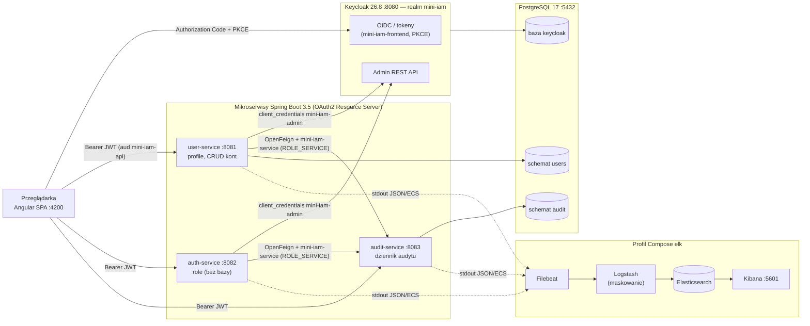
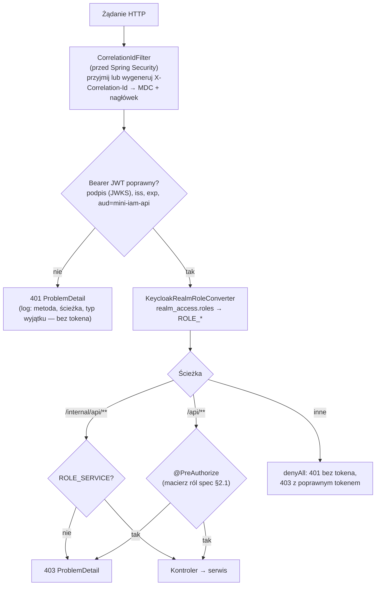
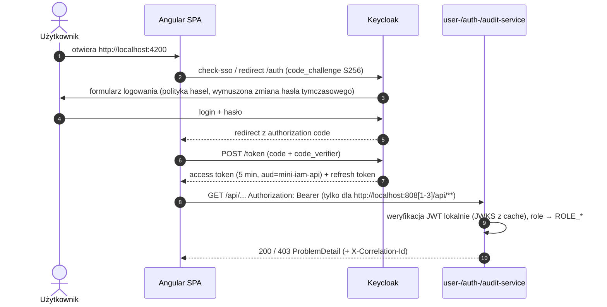
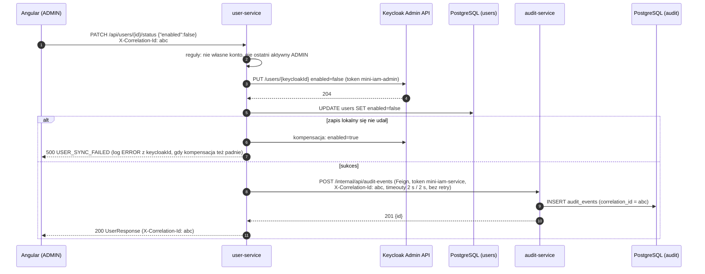
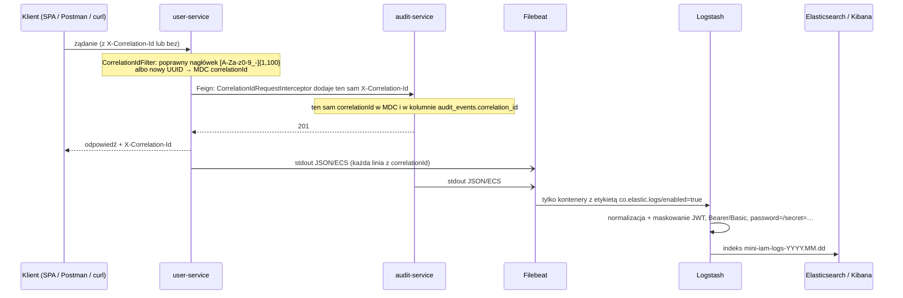

# Mini IAM Platform — architektura

Źródło prawdy dla wymagań: [`project-spec.md`](project-spec.md) (§4, §5, §7, §8, §11, §16). Ten dokument opisuje,
jak system jest zbudowany i jak przez niego płyną żądania, tokeny, zdarzenia audytu i logi.

## 1. Komponenty



Wersja tekstowa (dla edytorów bez Mermaid):

```text
Angular SPA ──(OIDC Code + PKCE)──────────────────────────> Keycloak (realm mini-iam)
Angular SPA ──(Bearer JWT, aud=mini-iam-api)──> user-service / auth-service / audit-service
user-service, auth-service ──(Admin REST API, client_credentials mini-iam-admin)──> Keycloak
user-service, auth-service ──(OpenFeign, client_credentials mini-iam-service, ROLE_SERVICE)──> audit-service
user-service ──> PostgreSQL schemat users      audit-service ──> PostgreSQL schemat audit
Keycloak ──> PostgreSQL baza keycloak
user/auth/audit-service ── stdout JSON/ECS ──> Filebeat ──> Logstash ──> Elasticsearch ──> Kibana
```

| Komponent | Port | Dane | Odpowiedzialność |
|---|---|---|---|
| `user-service` | 8081 | PostgreSQL, schemat `users` (użytkownik DB `user_service`) | profile użytkowników; tworzenie, edycja, (de)aktywacja i usuwanie kont w Keycloak z kompensacją przy częściowych awariach; audyt `USER_*` |
| `auth-service` | 8082 | brak — role są w Keycloak | odczyt, przypisywanie i odbieranie realm roles; `GET /api/auth/me`; audyt `ROLE_*` |
| `audit-service` | 8083 | PostgreSQL, schemat `audit` (użytkownik DB `audit_service`) | przyjmowanie zdarzeń (`/internal/api`) i ich odczyt; wpisy niezmienne |
| Keycloak 26.8 | 8080 | PostgreSQL, osobna baza `keycloak` | tożsamość, hasła, tokeny, role, polityka haseł, zdarzenia logowania |
| PostgreSQL 17 | 5432 | wolumen `postgres-data` | jedna instancja, izolacja przez schematy i użytkowników |
| ELK 9.5 (profil `elk`) | 9200, 5601 | wolumen `elasticsearch-data` | centralne logi, wyszukiwanie po `correlationId` |

Wszystkie porty są publikowane tylko na `127.0.0.1`. Nie ma API Gateway ani discovery (spec §11.2): SPA woła
serwisy bezpośrednio, a adresy serwisów pochodzą z konfiguracji środowiskowej.

## 2. Model bezpieczeństwa

### Klienci Keycloak

| Klient | Typ | Do czego | Co ma w tokenie | Czego nie może |
|---|---|---|---|---|
| `mini-iam-frontend` | public, Authorization Code + PKCE S256 | logowanie użytkowników w SPA | `aud=mini-iam-api`, `realm_access.roles` (role aplikacyjne) | direct grant, implicit; redirect tylko `http://localhost:4200` |
| `mini-iam-admin` | confidential, service account | Keycloak Admin REST API (user-, auth-service) | role `realm-management` (`view-users`, `query-users`, `manage-users`, `view-realm`), scope `kc-admin-api` | brak `aud=mini-iam-api` → API Mini IAM odrzuca jego token (401) |
| `mini-iam-service` | confidential, service account | wywołania serwis–serwis (Feign → audit-service) | `aud=mini-iam-api`, rola `SERVICE` | brak ról `realm-management` → Admin API odrzuca jego token |

Wszystkie klienty mają `fullScopeAllowed=false`, więc token zawiera tylko role z jawnych scope mappings.

### Weryfikacja żądań w serwisie



- Role aplikacyjne: `ADMIN`, `MANAGER`, `AUDITOR`, `USER` (bazowa, przez `default-roles-mini-iam`). `SERVICE`
  to znacznik konta technicznego — niewidoczny w `GET /api/roles` i nieprzypisywalny przez API.
- Polityka haseł realmu: min. 12 i maks. 128 znaków, różne od nazwy użytkownika i e-maila. Ta sama minimalna
  długość jest walidowana w `CreateUserRequest` i formularzu Angular, a odrzucenie przez Keycloak daje
  400 `INVALID_USER_DATA`.
- Keycloak zapisuje zdarzenia logowania (`LOGIN`, `LOGIN_ERROR`, `UPDATE_PASSWORD`… przez 7 dni) i zdarzenia
  administracyjne bez treści reprezentacji. Widać je w konsoli: realm `mini-iam` → *Events*. Brute force
  protection jest włączona.
- CORS tylko dla originów z `CORS_ALLOWED_ORIGINS`. Actuator udostępnia wyłącznie `health`, bez szczegółów.
  Odpowiedzi błędów nie zawierają stack trace ani komunikatów wyjątków.

## 3. Logowanie użytkownika (OIDC + PKCE)



Tokeny są trzymane w pamięci przez keycloak-js (bez `localStorage`). Zmiana ról działa po odświeżeniu tokena
(do 5 min) lub ponownym logowaniu (spec §11.2).

## 4. Operacja administracyjna z audytem

Przykład: ADMIN dezaktywuje konto. Tak samo działają pozostałe operacje user-service (`USER_CREATED`,
`USER_UPDATED`, `USER_DELETED`) i auth-service (`ROLE_ASSIGNED`, `ROLE_REMOVED`).



- **Kolejność:** najpierw Keycloak (źródło prawdy dla kont i ról), potem baza lokalna, na końcu audyt. Wywołania
  zewnętrzne nie są wykonywane w długich transakcjach bazodanowych.
- **Audyt best effort** (spec §7): gdy audit-service nie odpowiada, operacja i tak kończy się 2xx, a w logu jest
  ERROR `Audit event NOT recorded (operation already applied)` z typem zdarzenia, aktorem, celem
  i `correlationId`. Odrzucone operacje (4xx) nie są audytowane.
- auth-service nie ma bazy: każdy odczyt i zmiana ról idzie do Keycloak Admin API. Reguły (`SELF_ROLE_CHANGE`,
  `LAST_ADMIN`, `SERVICE_ACCOUNT_PROTECTED`, `ROLE_NOT_ASSIGNABLE`) są sprawdzane przed zmianą.

## 5. Śledzenie żądań i logi



- Filtr `X-Correlation-Id` jest skopiowany do każdego serwisu, a interceptor Feign do user- i auth-service
  (bez modułu współdzielonego).
- Serwisy nie logują tokenów, nagłówka `Authorization`, haseł, sekretów ani pełnych body. Sprawdzają to testy
  `LogHygieneTest` (każdy serwis) i `scripts/e2e-smoke.sh`. Maskowanie w Logstash to dodatkowe zabezpieczenie,
  gdyby taki ciąg trafił do komunikatu lub stack trace.
- Brak lub awaria ELK nie wpływa na serwisy: logują na stdout, a zbieraniem zajmuje się Filebeat.
- Jak wyszukać żądanie w Kibanie: [`README.md`](../README.md#10-logi-i-śledzenie-żądań-elk).

## 6. Izolacja danych (spec §8.4)

- `user_service` jest właścicielem wyłącznie schematu `users`, a `audit_service` wyłącznie schematu `audit`.
  Żaden z nich nie ma uprawnień do schematu `public` ani do cudzych schematów.
- Keycloak używa osobnej bazy `keycloak` i użytkownika `keycloak`. Użytkownicy serwisów nie mają do niej
  `CONNECT`.
- Każdy serwis wykonuje własne migracje Liquibase (`databasechangelog*` w swoim schemacie), Hibernate działa
  z `ddl-auto=validate`.
- Serwisy nie współdzielą encji ani repozytoriów. Łączy je tylko REST (Feign) z własnymi DTO po obu stronach.

## 7. Ograniczenia środowiska lokalnego

Konfiguracja jest przeznaczona do uruchomienia lokalnego (spec §11.2). Przed użyciem w innym środowisku trzeba
zmienić m.in.:

- HTTP zamiast HTTPS: Keycloak działa w `start-dev`, Elasticsearch bez TLS (porty tylko na `127.0.0.1`).
- Filebeat działa jako root z zamontowanym `docker.sock` (autodiscover). To w praktyce uprawnienia roota
  na hoście Dockera.
- SPA nie ma nagłówka Content-Security-Policy, a fonty ładuje z Google Fonts.
- Konta demonstracyjne z realm importu (`manager`, `auditor`, `user`) mają wspólne hasło tymczasowe z `.env`.
- Nieoczekiwane wyjątki są logowane z pełnym stack trace, a kompensacje w user-service logują `username`.
  W odpowiedzi HTTP nie ma tych danych.
- ELK to jeden węzeł bez retencji (ILM) i HA. Audyt nie ma outboxa (best effort).
- Reguła ostatniego administratora nie jest atomowa: dwie równoczesne operacje na dwóch ostatnich adminach
  mogą obie przejść.
